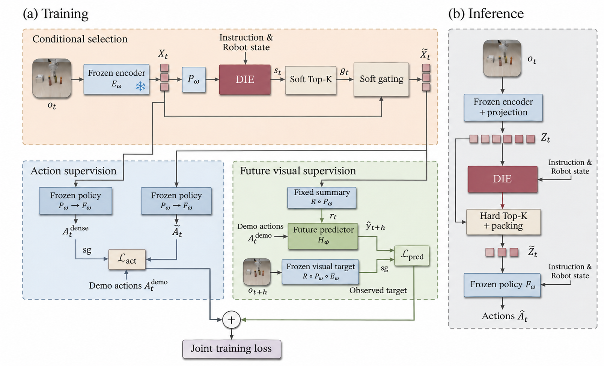

# APS-VLA

[Paper on arXiv](https://doi.org/10.48550/arXiv.2611.13030)

**Action-Guided and Future-Aware Token Pruning for Efficient Vision-Language-Action Models.** APS-VLA trains a visual token selector with two signals from robot demonstrations. Selected tokens should preserve the frozen policy's actions and help predict how the scene changes after the demonstrated action. At inference, the selector scores tokens using the current images, instruction and robot state. It keeps the top-scoring tokens from each camera and packs them for one policy forward pass.

## Architecture



## Experimental design

- **LIBERO.** We prune OpenVLA-OFT's 512 visual tokens to 256, 128 or 64 and evaluate closed-loop success across Spatial, Object, Goal and Long. Matched selectors trained with and without future supervision isolate the effect of the auxiliary objective.
- **RoboCasa365.** We evaluate π0.5 and XR-1 on seen atomic, seen composite and unseen composite tasks. Results below average the 256- and 128-token budgets.
- **Real robots.** We evaluate five tasks on dual-arm THESEUS-S1 and UR5 platforms, with 40 trials per task and policy.

## Quick start

To run the OpenVLA-OFT/LIBERO implementation, follow the [setup and testing guide](docs/setup.md). It lists the training, rollout evaluation and latency profiling entry points. See also the [training objective](src/cti_vla/training/future_auxiliary.py), [deployment code](src/cti_vla/evaluation/formal_runtime.py) and [experiment configurations](configs/experiments/formal_main_v2).

## Results

**LIBERO.** Mean success across four suites and policy inference latency.

| OpenVLA-OFT | Tokens | Success (%) ↑ | Latency (ms) ↓ | Speedup ↑ |
|---|---:|---:|---:|---:|
| Unpruned | 512 | 97.00 | 107.95 | 1.00× |
| APS-VLA | 256 | 96.58 | 81.39 | 1.33× |
| APS-VLA | 128 | 95.75 | 68.75 | 1.57× |
| APS-VLA | 64 | 93.92 | 66.21 | 1.63× |

**RoboCasa365.** Success (%) by task split and policy inference latency.

| Policy | Atomic seen ↑ | Composite seen ↑ | Composite unseen ↑ | Latency (ms) ↓ | Speedup ↑ |
|---|---:|---:|---:|---:|---:|
| π0.5 | 39.60 | 7.10 | 1.20 | 70.29–70.30 | 1.00× |
| π0.5 + APS-VLA | 39.15 | 6.71 | 1.21 | 51.50 | 1.37× |
| XR-1 | 80.23 | 57.10 | 32.10 | 217.25 | 1.00× |
| XR-1 + APS-VLA | 79.77 | 55.67 | 30.97 | 142.93 | 1.52× |

**Real robots.** Mean results across five tasks.

| Policy | Success (%) ↑ | Latency (ms) ↓ | Speedup ↑ |
|---|---:|---:|---:|
| π0.5 | 60.00 | 137.25 | 1.00× |
| π0.5 + APS-VLA | 61.00 | 93.25 | 1.47× |

## Cite APS-VLA

<details>
<summary>BibTeX</summary>

```bibtex
@misc{xing2026apsvlaactionguidedfutureawaretoken,
  title={APS-VLA: Action-Guided and Future-Aware Token Pruning for Efficient Vision-Language-Action Models},
  author={Xiaoyang Xing and Chun-Mei Feng and Anthony Cohn and Xiaoliang Gong and Asoke Nandi},
  year={2026},
  eprint={2611.13030},
  archivePrefix={arXiv},
  primaryClass={cs.AI},
  url={https://arxiv.org/abs/2611.13030},
}
```

</details>
